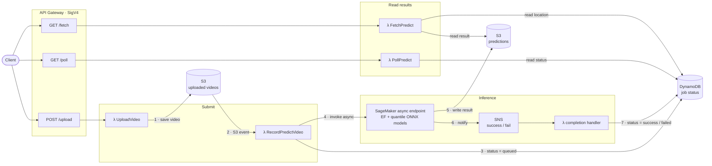

# SERVE-CONFIDEF

Serving EchoNet ejection-fraction predictions with calibrated **90% prediction intervals** on AWS SageMaker Asynchronous Inference.

---

## 1. Architecture



The client uploads a video and gets back a `job_id`, polls `/poll` until the job is `success` or `failed`, then calls `/fetch` for the prediction.

More detail:

- [docs/architecture.md](docs/architecture.md): step-by-step sequence diagrams for submitting and fetching a prediction
- [docs/api.md](docs/api.md): full API reference for `/upload`, `/poll` and `/fetch`
- [docs/design-decisions.md](docs/design-decisions.md): why asynchronous inference, ONNX, and SageMaker over EC2
- [docs/known-limitations.md](docs/known-limitations.md): known weaknesses and how they could be fixed

---

## 2. API reference

Three SigV4-signed routes on API Gateway:

| Route | Purpose |
|---|---|
| `POST /upload` | Upload a raw `.avi` video and get a job ID back |
| `GET /poll?job_id=<id>` | Check the job status: `queued`, `success` or `failed` |
| `GET /fetch?job_id=<id>` | Get the EF point estimate and the 90% prediction interval |

See [docs/api.md](docs/api.md) for authentication, request and response shapes, and status codes. [`examples/example_calls.ipynb`](examples/example_calls.ipynb) has an example call for each route.

## 3. Known limitations

- **`/poll` can return 404 straight after upload.** The job record is written to DynamoDB asynchronously after the video lands in S3, so polling too early returns `404` until it exists. See [docs/known-limitations.md](docs/known-limitations.md) for the cause and possible fixes.

## Configuration

There are two config files, both git-ignored.

`config.ini` in the repo root holds the inference settings. It is baked into the Docker image and read by `serve.py`:

```ini
[model]
ef_model_filename = ef_model.onnx
qr_model_filename = quantile_model.onnx
batch_size = 4
num_frames = 64
period = 2
target_image_size = 112
```

`infra/config.ini` holds the deployment settings (`[aws]` and `[autoscaling]`) read by `infra/deploy_endpoint.py` and `infra/deploy_api.py`. Copy [infra/config.example.ini](infra/config.example.ini) and fill in the placeholders:

```bash
cp infra/config.example.ini infra/config.ini
```

The `[autoscaling]` values are explained in [docs/scaling.md](docs/scaling.md).

**Environment variables**

| Variable | Default | Effect |
|---|---|---|
| `MODEL_DIR` | `/opt/ml/model` | Where the ONNX files live; falls back to `models` if absent |
| `PORT` | `8080` | uvicorn listen port |
| `VIDEO_EXT` | `avi` | Temp-file suffix for the uploaded bytes, so OpenCV picks the right decoder |

---

## Docker build and ECR push

```bash
# Build for the cloud — the platform/provenance flags are REQUIRED
docker build -t echoserve .

docker tag echoserve <account-id>.dkr.ecr.<region>.amazonaws.com/echo:latest

aws ecr get-login-password --region <region> docker login --username AWS --password-stdin <account-id>.dkr.ecr.<region>.amazonaws.com

docker push <account-id>.dkr.ecr.<region>.amazonaws.com/echo:latest
```

Run the same image locally:

```bash
docker build -t echoserve .
docker run --rm -p 8080:8080 -v "$(pwd)/models:/opt/ml/model" echoserve
```
---

## Deploy to SageMaker

```bash
python infra/deploy_endpoint.py --action deploy      # create model → endpoint config → endpoint → wait
python infra/deploy_endpoint.py --action teardown    # delete all three
```

`deploy_endpoint.py --action deploy` runs `create_model()` → `create_endpoint_config()` → `create_endpoint()`, then blocks on the `endpoint_in_service` waiter and prints `endpoint InService`. Each create step is idempotent — an existing resource is logged and skipped.

What gets provisioned:

- **Model** — points at the ECR image with `ModelDataSource` as an **uncompressed** `S3Prefix` (`CompressionType: "None"`), so the two ~120 MB `.onnx` files are mounted directly at `/opt/ml/model`. No `model.tar.gz` packaging step.
- **Endpoint config** — one `ml.m5.xlarge` instance, variant `AllTraffic`, `MaxConcurrentInvocationsPerInstance: 1`, async output to `s3://<your-bucket>/echo-serve/preds-success/` and failures to `.../preds-fail/`.
- **Endpoint** — `serving-echo-async`.

---

## Deploy the API Gateway

```bash
pip install boto3
python infra/deploy_api.py
```

The script reads `infra/config.ini` (it can be run from any directory) and uses these `[aws]` keys:

| Key | Default | Effect |
|---|---|---|
| `region` | required | Fills `{REGION}` in the template and sets the boto3 region |
| `account_id` | required | Fills `{ACCOUNT_ID}` in the template |
| `profile` | `default` | AWS CLI profile to use |
| `template` | `infra/gateway/gateway.json` | Template path, relative to the repo root |
| `stage` | `dev` | Stage to deploy to |

It renders the template to `rendered_policy/gateway.json`, then looks up a REST API by the template's `info.title` (`echo-predict`). If one exists, it is **overwritten in full**, so changes made in the console are lost. Otherwise a new API is imported. Either way, the API is then deployed to the stage and the invoke URL is logged.

The Lambda functions `UploadVideo`, `PollPredict` and `FetchPredict`, and the IAM role `apigateway-lambda-role`, must already exist.

---

## Future state: all infrastructure in Terraform

The goal is to deploy the entire stack from [infra/terraform/](infra/terraform/), so one `terraform apply` builds it and one `terraform destroy` removes it. 

Once every resource is in Terraform, `deploy_endpoint.py` and `deploy_api.py` can be retired. Existing resources will be adopted with `import` blocks, as [imports.tf](infra/terraform/imports.tf) already does for `UploadVideo`, so nothing has to be recreated.
