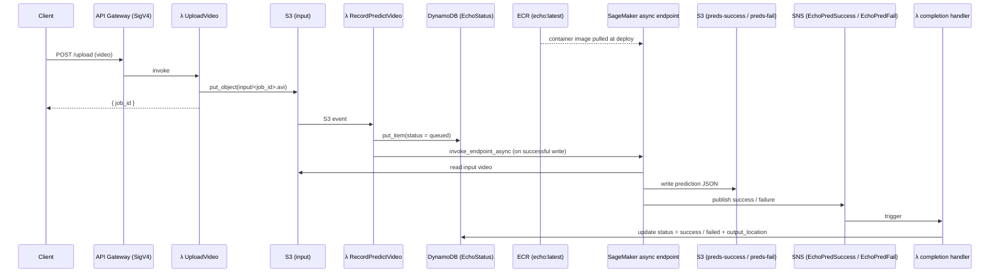
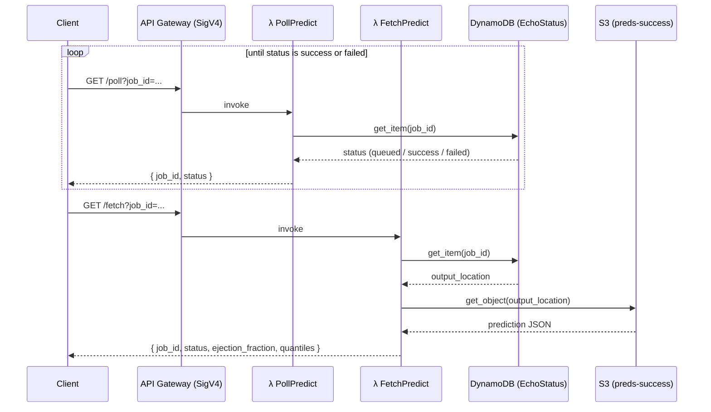

# SERVE-CONFIDEF

Serving EchoNet ejection-fraction predictions with calibrated **90% prediction intervals** on AWS SageMaker Asynchronous Inference.

---

## What is EchoNet?

An **echocardiogram** is a cardiac ultrasound a video of a beating heart. The single most important number read off one is the **ejection fraction (EF)**: the percentage of blood the left ventricle pushes out with each beat. Roughly 55–70% is normal; below ~40% indicates reduced cardiac function and is a primary diagnostic criterion for heart failure. Measuring it conventionally means a clinician manually tracing the ventricle at end-systole and end-diastole, which is slow and varies between readers. **EchoNet-Dynamic** (Stanford) is the public dataset and model family that automates this: ~10,036 apical-4-chamber echo clips at 112×112 with expert EF labels, with **R(2+1)D-18** as the reference architecture regressing EF directly from a video clip — no manual tracing, no intermediate segmentation. This repo serves that architecture: video in, EF out. 

A bare point estimate, though, is misleading for this task, even expert readings on the same clip can disagree by several percentage points, and the model itself is far more confident on some clips (clean acquisition, clear endocardial border) than others, so a prediction of "42%" that could plausibly be anywhere from 35% to 49% is a very different clinical object than one that's tightly pinned down, a distinction a single float simply can't convey; to capture that, this service reports a 90% prediction interval alongside the point estimate.

---

# Architecture

## Submitting a prediction



## Polling and fetching result



---

# API reference

### `GET /ping`

SageMaker health check.

- `200` → `{"status": "ok"}`
- `503` → `{"detail": "ef model not loaded"}` or `"qr model not loaded"`

### `POST /invocations`

The request body is the **raw video file bytes** — not JSON, not multipart form data. The bytes are written to a temp file (suffixed per `VIDEO_EXT`) and decoded by OpenCV.

- `400` — empty request body
- `500` — decode or inference failure, with the exception message in `detail`

**Response (current behavior):**

```json
{
  "ejection_fraction": {
    "point_estimate": 58.2,
    "quantiles": [47.1, 69.4]
  }
}
```
---

## Configuration

`config.ini` is git-ignored. Create it in the repo root:

```ini
[model]
ef_model_filename = ef_model.onnx
qr_model_filename = quantile_model.onnx
batch_size = 4
num_frames = 64
period = 2
target_image_size = 112

[aws]
region = us-east-1
account_id = <account-id>
bucket = <your-bucket>
ecr_repo = echo:latest
model_data_prefix = models/
role_name = arn:aws:iam::<account-id>:role/service-role/<sagemaker-execution-role>
model_name = serving-echo-model
config_name = serving-echo-async-config
max_concurrent = 1
endpoint = serving-echo-async
instance = ml.m5.xlarge
```

**Environment variables**

| Variable | Default | Effect |
|---|---|---|
| `MODEL_DIR` | `/opt/ml/model` | Where the ONNX files live; falls back to `models` if absent |
| `PORT` | `8080` | uvicorn listen port |
| `VIDEO_EXT` | `avi` | Temp-file suffix for the uploaded bytes, so OpenCV picks the right decoder |

---


## Docker build and ECR push

```bash
# Build for the cloud — the platform/provenance flags are REQUIRED
docker build --platform linux/amd64 --provenance=false --sbom=false \
             --output type=docker -t echoserve .

docker tag echoserve <account-id>.dkr.ecr.<region>.amazonaws.com/echo:latest

aws ecr get-login-password --region <region> \
  | docker login --username AWS --password-stdin \
        <account-id>.dkr.ecr.<region>.amazonaws.com

docker push <account-id>.dkr.ecr.<region>.amazonaws.com/echo:latest
```

`--provenance=false --sbom=false` are not optional: without them BuildKit emits an OCI multi-arch manifest with attestations, which SageMaker rejects at `create_model` time with an unhelpful image-format error. `--platform linux/amd64` matters when building on Apple Silicon.

Run the same image locally, mounting the models rather than baking them in:

```bash
docker build -t echoserve .
docker run --rm -p 8080:8080 -v "$(pwd)/models:/opt/ml/model" echoserve
```

---

## Deploy to SageMaker

```bash
aws s3 cp models/ s3://<your-bucket>/models/ --recursive

python deploy.py --action deploy      # create model → endpoint config → endpoint → wait
python deploy.py --action teardown    # delete all three
```

`deploy.py --action deploy` runs `create_model()` → `create_endpoint_config()` → `create_endpoint()`, then blocks on the `endpoint_in_service` waiter and prints `endpoint InService`. Each create step is idempotent — an existing resource is logged and skipped.

What gets provisioned:

- **Model** — points at the ECR image with `ModelDataSource` as an **uncompressed** `S3Prefix` (`CompressionType: "None"`), so the two ~120 MB `.onnx` files are mounted directly at `/opt/ml/model`. No `model.tar.gz` packaging step.
- **Endpoint config** — one `ml.m5.xlarge` instance, variant `AllTraffic`, `MaxConcurrentInvocationsPerInstance: 1`, async output to `s3://<your-bucket>/echo-serve/preds-success/` and failures to `.../preds-fail/`.
- **Endpoint** — `serving-echo-async`.

`teardown()` has no error handling and will raise if the resources are already gone.

---

## Invoking the async endpoint

```python
import boto3, json, time
from urllib.parse import urlparse

s3 = boto3.client("s3", region_name="<region>")
rt = boto3.client("sagemaker-runtime", region_name="<region>")

BUCKET = "<your-bucket>"
s3.upload_file("study.avi", BUCKET, "input/study.avi")

resp = rt.invoke_endpoint_async(
    EndpointName="serving-echo-async",
    InputLocation=f"s3://{BUCKET}/input/study.avi",
)
out = urlparse(resp["OutputLocation"])   # s3://<bucket>/echo-serve/preds-success/<uuid>.out

# Poll until the result object appears
while True:
    try:
        body = s3.get_object(Bucket=out.netloc, Key=out.path.lstrip("/"))["Body"].read()
        break
    except s3.exceptions.NoSuchKey:
        time.sleep(5)

result = json.loads(body)["ejection_fraction"]
q = result["quantiles"]
print(f"EF {result['ejection_fraction']:.1f}% (90% PI: {q[0]:.1f}–{q[1]:.1f})")
```

SageMaker streams the S3 object straight into the container as the `/invocations` body, so the container never needs S3 credentials of its own.

---

## Local development

Requires Python 3.11.

```bash
pip install -r requirements.txt

# Create config.ini (see Configuration below), then place the ONNX
# artifacts in ./models/

python serve.py                    # uvicorn on 0.0.0.0:8080
```

In another shell:

```bash
curl -s localhost:8080/ping
# {"status":"ok"}

curl -s -X POST --data-binary @test/0X1A3E7BF1DFB132FB.avi \
     localhost:8080/invocations
```

`MODEL_DIR` (`serve.py:9-11`) defaults to `/opt/ml/model` and **falls back to `./models`** when that path doesn't exist — which is what lets the same code run locally and in SageMaker with no changes.

---