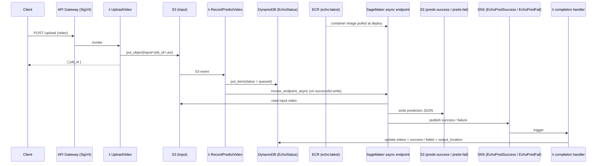
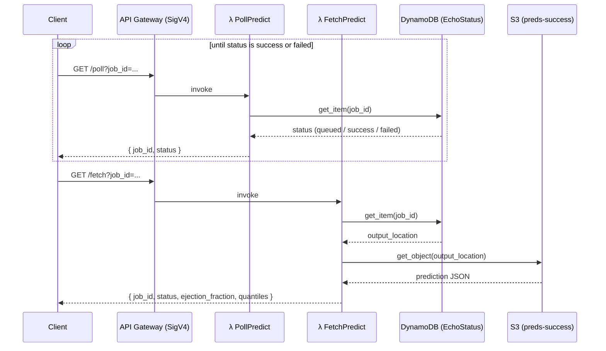

# SERVE-CONFIDEF

Serving EchoNet ejection-fraction predictions with calibrated **90% prediction intervals** on AWS SageMaker Asynchronous Inference.
---

## 1. Architecture

### 1.1 Submitting a prediction



### 1.2 Polling and fetching result



---

## 2. API reference

### 2.1 API Gateway

**Base URL:** `https://<api-id>.execute-api.<region>.amazonaws.com/<stage>`.

**Authentication:** every route uses IAM auth. Requests must be signed with **SigV4**. Unsigned or wrongly signed requests are rejected by API Gateway with `403` before any Lambda runs.

All responses are JSON (`Content-Type: application/json`). Errors have the shape `{"error": "<message>"}`.

**Job lifecycle:** `POST /upload` → poll `GET /poll` until `status` is `success` or `failed` → `GET /fetch` for the result.

| Status | Meaning |
|---|---|
| `queued` | Job recorded in DynamoDB and sent to the SageMaker async endpoint |
| `success` | Prediction written to S3. Call `/fetch` |
| `failed` | Inference failed. `failure_reason` may be included |

### `POST /upload`

Upload one echo video. The request body is the **raw `.avi` file bytes**, not multipart form data or JSON.

**Headers**

| Header | Notes |
|---|---|
| `Content-Type` | Must be `video/x-msvideo`|

**`201 Created`**

```json
{
  "id": "3f2b8c1e-9d4a-4e7b-a1c2-5f6e7d8c9b0a"
}
```

### `GET /poll?job_id=<id>`

Return the current status of a job. Reads DynamoDB with strong consistency, so a status change is visible right away.

```json
{
  "job_id": "3f2b8c1e-9d4a-4e7b-a1c2-5f6e7d8c9b0a",
  "status": "queued",
  "created_at": "2026-11-01T07:45:08.574570+00:00"
}
```
or 
```json
{
  "job_id": "3f2b8c1e-9d4a-4e7b-a1c2-5f6e7d8c9b0a",
  "status": "success",
  "created_at": "2026-11-01T07:45:08.574570+00:00"
}
```
or 
```json
{
  "job_id": "3f2b8c1e-9d4a-4e7b-a1c2-5f6e7d8c9b0a",
  "status": "failed",
  "created_at": "2026-11-01T07:45:08.574570+00:00"
}
```

### `GET /fetch?job_id=<id>`

Return the prediction for a finished job.


```json
{
  "job_id": "3f2b8c1e-9d4a-4e7b-a1c2-5f6e7d8c9b0a",
  "status": "success",
  "ejection_fraction": 65.23590087890625,
  "quantiles": [58.1862678527832, 73.97683715820312]
}
```
`ejection_fraction` is the point estimate in percent. `quantiles` is the lower and upper bound of the 90% prediction interval.

Example of calling each endpoint can be found in example_calls.py

## Configuration

`config.ini` is git-ignored. Create it in the repo root:

```ini
[model]
ef_model_filename = ef_model.onnx
qr_model_filename = quantile_model.onnx
batch_size = 4
num_frames = 64
period = 2
target_image_size = 112

[aws]
region = us-east-1
account_id = <account-id>
bucket = <your-bucket>
ecr_repo = echo:latest
model_data_prefix = models/
role_name = arn:aws:iam::<account-id>:role/service-role/<sagemaker-execution-role>
model_name = serving-echo-model
config_name = serving-echo-async-config
max_concurrent = 1
endpoint = serving-echo-async
instance = ml.g6.xlarge
variant_name = primary
enable_sns = true
```

**Environment variables**

| Variable | Default | Effect |
|---|---|---|
| `MODEL_DIR` | `/opt/ml/model` | Where the ONNX files live; falls back to `models` if absent |
| `PORT` | `8080` | uvicorn listen port |
| `VIDEO_EXT` | `avi` | Temp-file suffix for the uploaded bytes, so OpenCV picks the right decoder |

---

## Docker build and ECR push

```bash
# Build for the cloud — the platform/provenance flags are REQUIRED
docker build -t echoserve .

docker tag echoserve <account-id>.dkr.ecr.<region>.amazonaws.com/echo:latest

aws ecr get-login-password --region <region> docker login --username AWS --password-stdin <account-id>.dkr.ecr.<region>.amazonaws.com

docker push <account-id>.dkr.ecr.<region>.amazonaws.com/echo:latest
```

Run the same image locally:

```bash
docker build -t echoserve .
docker run --rm -p 8080:8080 -v "$(pwd)/models:/opt/ml/model" echoserve
```
---

## Deploy to SageMaker

```bash
python deploy.py --action deploy      # create model → endpoint config → endpoint → wait
python deploy.py --action teardown    # delete all three
```

`deploy.py --action deploy` runs `create_model()` → `create_endpoint_config()` → `create_endpoint()`, then blocks on the `endpoint_in_service` waiter and prints `endpoint InService`. Each create step is idempotent — an existing resource is logged and skipped.

What gets provisioned:

- **Model** — points at the ECR image with `ModelDataSource` as an **uncompressed** `S3Prefix` (`CompressionType: "None"`), so the two ~120 MB `.onnx` files are mounted directly at `/opt/ml/model`. No `model.tar.gz` packaging step.
- **Endpoint config** — one `ml.m5.xlarge` instance, variant `AllTraffic`, `MaxConcurrentInvocationsPerInstance: 1`, async output to `s3://<your-bucket>/echo-serve/preds-success/` and failures to `.../preds-fail/`.
- **Endpoint** — `serving-echo-async`.
