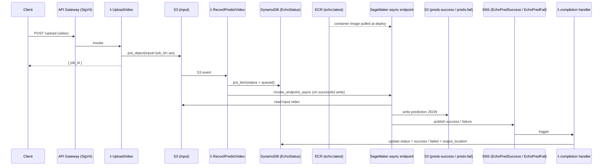
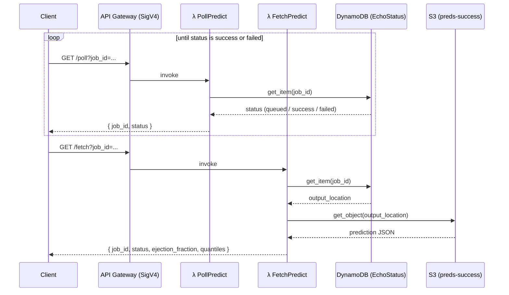

# Architecture

Detailed request flows for SERVE-CONFIDEF. For the high-level overview, see the [README](../README.md#1-architecture).

## Submitting a prediction

## Polling and fetching the result

